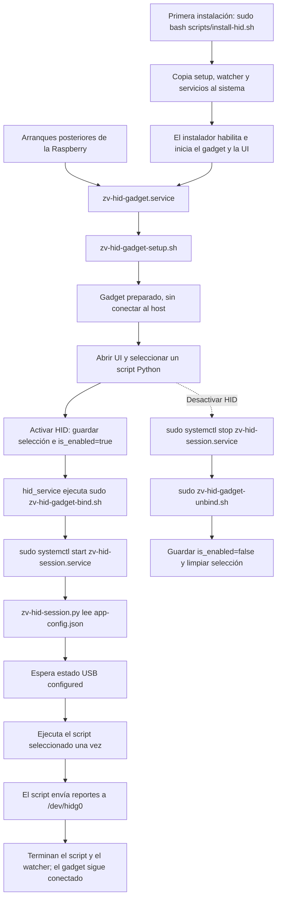

# ZeroVolts UI

ZeroVolts UI es un proyecto personal que estoy desarrollando en C con LVGL, usando una Raspberry Pi 4 con Parrot OS.

La idea es hacer una herramienta portátil con pantalla, botones y varios módulos para experimentar con señales de radio y otros dispositivos. Por ahora estoy trabajando con infrarrojo, Bluetooth Low Energy, USB HID y Sub-GHz. De paso, voy aprendiendo electrónica, programación y cómo juntar todo en una misma interfaz.

El proyecto sigue en desarrollo, así que la estructura, el protocolo y las funciones pueden cambiar. Algunas cosas ya se pueden usar y otras todavía están en pruebas o necesitan más trabajo.

## Contenido

- [Hardware y funcionamiento general](#hardware-y-funcionamiento-general)
- [Preparación: compilar LVGL primero](#preparación-compilar-lvgl-primero)
- [Compilar y ejecutar ZeroVolts UI](#compilar-y-ejecutar-zerovolts-ui)
- [Funciones actuales](#funciones-actuales)
- [Conexiones y pines](#conexiones-y-pines)
- [Comunicación con el ESP32](#comunicación-con-el-esp32)
- [Arquitectura y directorios](#arquitectura-y-directorios)
- [Configuración y datos](#configuración-y-datos)
- [Ejemplos y pruebas](#ejemplos-y-pruebas)
- [Estado y próximos aprendizajes](#estado-y-próximos-aprendizajes)

## Hardware y funcionamiento general

La Raspberry Pi se encarga de la interfaz y de los archivos. El ESP32 maneja BLE y el módulo CC1101 para Sub-GHz. Los dos se comunican por UART.

```text
Pantalla táctil + botones
           │
     Raspberry Pi
      ZeroVolts UI
       ├── Infrarrojo RX/TX
       ├── USB HID
       └── UART ── ESP32
                     ├── Bluetooth Low Energy
                     └── SPI ── CC1101 (Sub-GHz)
```

| Elemento | Uso actual |
|---|---|
| Raspberry Pi 4 con Parrot OS | Ejecuta la aplicación y guarda configuración, mandos y señales. |
| Pantalla SPI touch de 320 × 240 | Interfaz LVGL mediante framebuffer y entrada táctil mediante `evdev`; el montaje actual usa ADS7846 para el touch. |
| Dos pulsadores físicos | NAV para desplazarse y SELECT para seleccionar. |
| Receptor y transmisor IR | Aprender botones de mandos y volver a enviar sus señales. |
| ESP32 DevKit | Ejecuta el firmware de BLE y Sub-GHz y responde por UART. |
| CC1101 conectado al ESP32 | Captura y retransmisión experimental de señales de radio. |
| Conexión USB de datos de la Raspberry Pi | Función USB HID mediante el modo gadget de Linux. |

El firmware del ESP32 se mantiene en otro proyecto: [`zerovolts_firmware`](../zerovolts_firmware/).

## Preparación: compilar LVGL primero

**Antes de compilar la aplicación, hay que compilar LVGL.** El `Makefile` usa la biblioteca externa `liblvgl.a`; al ejecutar `make` en este proyecto, LVGL no se descarga ni se compila automáticamente.

Para descargar y compilar LVGL y preparar la pantalla, sigue el [tutorial de LVGL para Raspberry Pi](https://zerovolts-site.pages.dev/meta/03-lvgl-raspberry/#2-herramientas-necesarias-y-descarga-de-lvgl). Más abajo dejo las versiones y los ajustes que uso en ZeroVolts UI.

### Dependencias

Estas son las dependencias que uso en mi instalación:

```bash
sudo apt install build-essential cmake git python3 pkg-config libevdev-dev libgpiod-dev v4l-utils evtest
```

`libevdev` permite trabajar con la entrada táctil; `libgpiod`, con los pulsadores; e `ir-ctl`, incluido en `v4l-utils`, se usa para infrarrojo. El driver actual de botones utiliza la API de **libgpiod 1.x**; una instalación con la API 2.x requiere adaptar ese driver.

### Versiones del entorno actual

Estas son las versiones que tengo instaladas. Las dejo como referencia. El proyecto usa LVGL 9.

| Componente | Versión o revisión observada |
|---|---|
| Sistema operativo | Parrot Security 6.4 (lorikeet), ARM64 (`aarch64`) |
| Kernel Linux | `6.12.93+rpt-rpi-v8` |
| GCC del host | `12.2.0`, paquete Debian `12.2.0-14+deb12u1` |
| GNU Make | `4.3` |
| CMake del sistema | `3.25.1` |
| Python | `3.11.2` |
| libgpiod | `1.6.3` |
| libevdev | `1.13.0` |
| ir-ctl | `1.22.1` |
| LVGL | `9.4.0` |

El ESP32 usa PlatformIO Core **6.2.0**, plataforma **espressif32 6.12.0**, **ESP-IDF 5.5.0** y GCC Xtensa **14.2.0**. Las versiones y la configuración del coprocesador se detallan en el [README del firmware](../zerovolts_firmware/README.md#entorno-de-desarrollo-actual).

### Configuración de LVGL usada por la aplicación

El Makefile usa actualmente la configuración generada en `~/git/lv_port_linux/build/lv_conf.h`. Estos son los ajustes que necesita la aplicación:

| Opción | Valor actual |
|---|---|
| `LV_COLOR_DEPTH` | `16` |
| `LV_USE_LINUX_FBDEV` | `1` |
| `LV_LINUX_FBDEV_RENDER_MODE` | `LV_DISPLAY_RENDER_MODE_DIRECT` |
| `LV_LINUX_FBDEV_BUFFER_COUNT` | `2` |
| `LV_USE_EVDEV` | `1` |
| `LV_USE_FS_STDIO` | `1` |
| `LV_FS_STDIO_LETTER` | `'A'` |
| `LV_FS_STDIO_PATH` | `""` |
| `LV_USE_LODEPNG` | `1` |
| `LV_FONT_MONTSERRAT_10`, `LV_FONT_MONTSERRAT_12`, `LV_FONT_MONTSERRAT_14` | `1` |
| `LV_FONT_DEFAULT` | `&lv_font_montserrat_14` |
| `LV_USE_OS` | `LV_OS_NONE` |
| `LV_USE_STDLIB_MALLOC` | `LV_STDLIB_CLIB` |

En `lv_conf.defaults`, las opciones se escriben como `NOMBRE valor`, sin `#define`. Mantén ahí los ajustes y recompila para que la biblioteca y sus cabeceras coincidan. `LV_MEM_SIZE` está definido como `256 * 1024U`, pero solo se aplica con `LV_STDLIB_BUILTIN`; la configuración generada actual usa el asignador de C (`LV_STDLIB_CLIB`).


Antes de continuar, debe existir:

```text
~/git/lv_port_linux/build/lvgl/lib/liblvgl.a
```

Además de esa biblioteca, el [Makefile](Makefile) utiliza las cabeceras de `lvgl/`, los drivers de framebuffer y `evdev`, y la configuración generada en `build/`. El proyecto usa LVGL 9; los cambios entre versiones del port pueden requerir ajustes.

## Compilar y ejecutar ZeroVolts UI

La ejecución manual es el procedimiento predeterminado de esta guía. Con LVGL compilado, el hardware configurado y los servicios HID instalados según la sección USB HID, desde la raíz de este repositorio:

```bash
make
sudo systemctl disable --now zerovolts-ui.service
sudo systemctl start zv-hid-gadget.service
sudo ./bin/zero-volts-ui
```

Para limpiar el binario principal y los ejemplos, usa `make clean`.

### Comprobar dispositivos antes de ejecutar

Después de configurar los overlays y reiniciar, comprueba los dispositivos del montaje:

```bash
ls -l /dev/fb0 /dev/gpiochip0 /dev/ttyAMA5 /dev/lirc0 /dev/lirc1
cat /proc/bus/input/devices
ls -l /dev/input/event*
ls /sys/class/udc
sudo systemctl status zv-hid-gadget.service
ls -l /dev/hidg0
```

Sustituye las rutas por las configuradas en `app-config.json`. Los botones usan `/dev/gpiochip0`; el touch se detecta entre los dispositivos de entrada. Framebuffer, touch y GPIO corresponden a la interfaz; UART, LIRC y HID corresponden a sus módulos. Si falta un dispositivo, revisa su configuración de arranque y conexión antes de usar la función correspondiente. El servicio del gadget debe estar preparado para que exista `/dev/hidg0`.

La instalación y la configuración de arranque se realizan una vez, y se repiten cuando cambian el montaje o los scripts. El uso normal consiste en preparar el gadget e iniciar la aplicación. Actualmente la UI, el watcher y los scripts HID se ejecutan como root; no se requiere añadir el usuario a grupos de dispositivos para este procedimiento.

### Ejecutar mediante systemd y habilitar el arranque automático

El instalador HID también instala `zerovolts-ui.service`. Para iniciarlo solo en la sesión actual, cierra primero cualquier instancia manual y ejecuta:

```bash
sudo systemctl start zerovolts-ui.service
sudo systemctl status zerovolts-ui.service
```

`start` inicia el servicio sin habilitarlo para los siguientes arranques. Para que la UI arranque automáticamente al encender la Raspberry:

```bash
sudo systemctl enable --now zerovolts-ui.service
```

El servicio se ejecuta como root porque no declara `User=`. Inicia sin que el usuario tenga que iniciar sesión, espera al servicio del gadget y reinicia la UI si falla. Necesita que `bin/zero-volts-ui` exista y sea ejecutable; si falta, systemd omite el inicio. Después de compilarlo, ejecuta `sudo systemctl start zerovolts-ui.service`.

Para volver a la ejecución manual:

```bash
sudo systemctl disable --now zerovolts-ui.service
sudo ./bin/zero-volts-ui
```

Ejecuta el binario desde la raíz del repositorio y mantén una sola instancia de la UI. Para consultar los errores del servicio:

```bash
sudo journalctl -u zerovolts-ui.service -b -n 100 --no-pager
```

### Pantalla y touch

El framebuffer se configura en `app-config.json`; actualmente es `/dev/fb0`. El touch se busca automáticamente en `/proc/bus/input/devices`, primero por sus propiedades y después por el nombre del dispositivo. Si no se encuentra, la aplicación no completa el arranque.

La rotación y la calibración están ajustadas a mi pantalla en [main.c](main.c): se intercambian los ejes y se usan los valores `296, 294, 3931, 3843`. Si cambias de pantalla, revisa esos valores. Para identificar y comprobar el touch:

```bash
cat /proc/bus/input/devices
evtest /dev/input/eventN
```

Cambia `eventN` por el dispositivo de tu pantalla.

## Funciones actuales

### Navegación táctil y con pulsadores

Desde la pantalla principal se puede entrar a Bad USB, Infrared, Bluetooth y Sub-GHz. La interfaz se puede usar con el touch o con los botones NAV y SELECT. NAV mueve el foco y permite desplazarse por los desplegables y el teclado en pantalla; SELECT confirma la opción.

La navegación entre pantallas está en [page/navigation_page.c](page/navigation_page.c), y la lectura de los pulsadores está en [drivers/gpio_buttons.c](drivers/gpio_buttons.c). El filtrado básico de clicks y la traducción de pulsaciones a teclas LVGL siguen en `main.c`.

### USB HID / Bad USB

Desde la interfaz se pueden ver y seleccionar scripts, además de activar o desactivar la sesión HID. La idea es que la Raspberry Pi funcione como un dispositivo USB de entrada y ejecute acciones mediante scripts.

El proyecto incluye los scripts para crear el gadget, el watcher y los servicios necesarios. El flujo actual ejecuta **scripts Python `.py`** que escriben reportes de teclado en `/dev/hidg0`.

La UI guarda la selección y el estado antes de activar el gadget y arrancar `zv-hid-session.service`. El programa `zv-hid-session.py` (el watcher) espera a que el host termine la enumeración USB y ejecuta el script una sola vez. Reconectar el cable no lo vuelve a ejecutar: para una nueva ejecución, desactiva, vuelve a seleccionar el script y activa desde la UI. El watcher escribe su log en `zv-hid-session.log`, en la raíz del proyecto; la salida del script se puede consultar en el journal del servicio. La UI todavía no muestra el progreso ni el resultado final del proceso.

#### Preparar USB HID en la Raspberry Pi

Estos pasos son para mi montaje con Raspberry Pi 4 y Parrot OS. Se necesita el puerto **USB-C con datos**, un cable de datos y alimentación suficiente para la Raspberry y sus periféricos. Los puertos USB-A de la Pi 4 no son el puerto gadget. También puedes consultar la preparación del controlador en la [guía oficial de OTG de Raspberry Pi](https://pip-assets.raspberrypi.com/categories/685-app-notes-guides-whitepapers/documents/RP-009276-WP-1-Using%20OTG%20mode%20on%20Raspberry%20Pi%20SBCs.pdf).

1. Instala las herramientas necesarias:

   ```bash
   sudo apt install python3 sudo kmod udev util-linux xxd bsdextrautils
   ```

2. En `/boot/firmware/config.txt`, dentro de una sección aplicable a tu placa (por ejemplo `[all]`), agrega:

   ```ini
   dtoverlay=dwc2,dr_mode=peripheral
   ```

   La opción se escribe **`dtoverlay`**. En `/boot/firmware/cmdline.txt`, conserva la única línea existente y añade, separado por un espacio:

   ```text
   modules-load=dwc2,libcomposite
   ```

   Si ya existe `modules-load=...`, añade ambos módulos a su lista separados por comas. Reinicia la Raspberry. Después, `ls /sys/class/udc` debe mostrar un controlador. No cargues otro gadget como `g_hid` o `g_ether` sobre el mismo controlador para este montaje.

3. Cierra cualquier instancia manual de la UI y ejecuta el instalador desde la raíz del proyecto. Puedes instalar los servicios antes de compilar la aplicación o preparar sus dependencias de compilación:

   ```bash
   sudo bash scripts/install-hid.sh
   sudo systemctl disable --now zerovolts-ui.service
   ```

   Este script Bash copia los archivos del sistema en `/usr/local/lib/zerovolts/hid` y los tres servicios en `/etc/systemd/system`, completando la ruta del proyecto en las unidades de sesión y UI. Recarga systemd y ejecuta `systemctl enable --now zv-hid-gadget.service` y `systemctl reenable --now zerovolts-ui.service`: prepara el gadget, habilita ambos servicios para los siguientes arranques e inicia la UI si su binario está disponible. El segundo comando de este paso detiene y deshabilita la UI automática para conservar la ejecución manual predeterminada de esta guía; el servicio del gadget sigue habilitado. Repite ese comando cada vez que vuelvas a ejecutar el instalador si quieres mantener el modo manual. Si todavía no existe el binario o no es ejecutable, systemd omite el arranque de la UI sin marcarla como fallida; la instalación continúa. Los servicios se ejecutan como root, manteniendo el funcionamiento original. No configura usuarios, grupos, reglas udev ni permisos sudo.

   En `app-config.json`, `hid.config_scripts` mantiene la carpeta de scripts de la aplicación, relativa a la raíz del proyecto. No es una ruta de instalación del sistema. Para la estructura incluida, conserva estos campos:

   ```json
   "config_scripts": "scripts",
   "is_enabled": false
   ```

   La aplicación ejecuta con `sudo` los scripts `zv-hid-gadget-bind.sh` y `zv-hid-gadget-unbind.sh` de la carpeta indicada en `hid.config_scripts`. Estos conectan y desconectan directamente el gadget, como en las pruebas originales. Las copias del sistema se administran con el instalador, independientemente de ese atributo.

   El servicio del gadget prepara el descriptor y deja el gadget **sin conectar al host** hasta activarlo desde la UI. La sesión HID no se habilita al arrancar el sistema. Si mueves el proyecto o actualizas estos scripts, vuelve a ejecutar el instalador con la UI y la sesión cerradas. El instalador admite espacios en la ruta; para mantenerlo sencillo, rechaza comillas, barras invertidas, `$` y `%` en ella.

4. Prepara el ejemplo incluido y actualiza el listado de scripts en la UI:

   ```bash
   mkdir -p data/badusb
   cp examples/hid_test_script.py data/badusb/
   ```

   Conecta el USB-C al equipo de prueba y deja un editor de texto enfocado. En Bad USB, selecciona `hid_test_script.py` y activa la sesión. El ejemplo escribe `zero volts`, sin Enter ni atajos, usando códigos de teclado para letras minúsculas. El texto efectivo depende del layout del host; este ejemplo no implementa traducción de layouts.

#### Qué hace cada archivo y quién lo ejecuta

| Archivo en `scripts/` | Responsabilidad | Quién lo ejecuta |
|---|---|---|
| [install-hid.sh](scripts/install-hid.sh) | Comprueba las herramientas del setup, copia el setup y el watcher al sistema, instala los tres servicios y completa las rutas de sesión y UI. Los habilita y solicita su inicio; no requiere que la UI esté compilada. | El usuario, con `sudo`, durante la instalación o actualización. No conecta el gadget al host ni ejecuta el script seleccionado. |
| [zv-hid-gadget.service](scripts/zv-hid-gadget.service) | Servicio `oneshot` que prepara el gadget mediante el setup. `RemainAfterExit=yes` conserva el servicio como activo después de terminar el script. | systemd al iniciarlo; también en cada arranque si se habilitó con `enable`. |
| [zv-hid-gadget-setup.sh](scripts/zv-hid-gadget-setup.sh) | Prepara configfs, carga `libcomposite`, crea el gadget, escribe los descriptores USB y configura el teclado con reportes de 8 bytes. Deja el gadget sin enlazar al controlador USB. | `zv-hid-gadget.service`, usando la copia instalada en el sistema. |
| [zv-hid-gadget-bind.sh](scripts/zv-hid-gadget-bind.sh) | Obtiene el nombre del controlador de `/sys/class/udc` y lo escribe en el atributo `UDC` del gadget. Esto permite que el host lo enumere como teclado. | La aplicación mediante `sudo`, desde la carpeta indicada en `hid.config_scripts`. |
| [zv-hid-gadget-unbind.sh](scripts/zv-hid-gadget-unbind.sh) | Vacía el atributo `UDC`, desconectando el gadget del host. Conserva los descriptores creados por el setup. | La aplicación mediante `sudo`, desde la carpeta indicada en `hid.config_scripts`. |
| [zv-hid-session.service](scripts/zv-hid-session.service) | Arranca el watcher y le proporciona la raíz del proyecto mediante `ZV_PROJECT_ROOT`. Depende del servicio del gadget. Al detenerse, systemd termina los procesos de la sesión. | La aplicación solicita `sudo systemctl start/stop zv-hid-session.service`. El instalador añade la ruta real del proyecto. |
| [zv-hid-session.py](scripts/zv-hid-session.py) | Lee `app-config.json`, comprueba la activación y el script seleccionado, consulta el estado USB cada 0,5 segundos y ejecuta `python3 <script>` al recibir `configured`. Después termina. | `zv-hid-session.service`, usando la copia instalada. Actualmente se ejecuta como root, igual que el script seleccionado. |
| [zerovolts-ui.service](scripts/zerovolts-ui.service) | Arranca la interfaz cuando su binario es ejecutable, espera a que se prepare el gadget y reinicia la aplicación si falla. `ConditionFileIsExecutable` omite el inicio si falta el binario. El instalador completa las rutas con la ubicación real del proyecto. | El instalador lo habilita e inicia mediante systemd; después arranca con la Raspberry. |

Los archivos de `scripts/` son los originales del proyecto. El instalador copia al sistema únicamente el setup y el watcher, además de las unidades HID. Los scripts bind/unbind siguen ejecutándose desde el proyecto. Los scripts Python seleccionables se guardan en `hid.script_list_path`, normalmente `data/badusb/`.

#### Orden de ejecución y flujo HID



En el primer uso, ejecuta la preparación USB y los dos comandos de instalación descritos arriba. El instalador habilita el gadget y la UI, y el comando posterior deshabilita la UI para mantener su inicio manual. Que `zv-hid-gadget.service` aparezca como `active (exited)` es normal: su trabajo de preparación ya terminó. Con `hid.is_enabled=false`, la UI no inicia la sesión HID al abrirse. Si conservas una activación anterior en `true`, la UI intenta reactivarla al arrancar.

Si instalaste antes de compilar, prepara después LVGL y las dependencias según las secciones de compilación. Cuando el binario esté listo, inicia la UI:

```bash
make
sudo systemctl start zv-hid-gadget.service
sudo ./bin/zero-volts-ui
```

Para usar el servicio o habilitar el inicio automático de la UI, sigue la sección «Ejecutar mediante systemd y habilitar el arranque automático». Compilar por sí solo no inicia la aplicación.

**El gadget debe estar preparado antes de activar HID.** En el flujo actual, `hid_service.c` ejecuta bind antes de solicitar el arranque de la sesión. Si abres la UI manualmente, asegúrate de que el gadget esté preparado antes; la dependencia de `zv-hid-session.service` no lo hace por sí sola.

`zerovolts-ui.service` se habilita en `multi-user.target` y espera a `zv-hid-gadget.service` y `getty.target`: systemd prepara el gadget y alcanza el punto de arranque de los servicios de login de consola antes de arrancar la aplicación. No requiere LightDM ni un escritorio gráfico. No espera a que el usuario inicie sesión. El instalador usa `reenable` para retirar enlaces de habilitación anteriores, incluido el de `graphical.target`. La aplicación usa la ruta generada por el instalador. Evita abrir otra instancia manual de la aplicación mientras este servicio esté ejecutándola. Puedes consultar su estado con `systemctl status zerovolts-ui.service`.

La lista de scripts se lee desde `hid_controller.c` y `hid_service.c`, que enumeran los archivos `.py` de `hid.script_list_path`. Al activar, el controller guarda la ruta seleccionada y `is_enabled=true` antes de llamar al servicio HID. El watcher lee esos datos al arrancar; no actualiza la selección continuamente ni tiene un timeout de espera del host.

Cuando el script finaliza, el watcher termina y no vuelve a ejecutarlo al reconectar el cable. El gadget permanece conectado y `is_enabled` conserva `true`: ese campo representa la activación solicitada, no el estado del proceso. Al desactivar desde la UI, primero se detiene la sesión, después se hace unbind y, si esas operaciones tienen éxito, se guarda `is_enabled=false` y se limpia la selección. Para repetir una ejecución, vuelve a seleccionar el script después de desactivar.

#### Configuración y diagnóstico HID

| Campo en `app-config.json` | Uso |
|---|---|
| `hid.script_list_path` | Carpeta de scripts Python seleccionables, por defecto `data/badusb/`. |
| `hid.script_selected_path` | Script elegido; lo guarda la UI antes de iniciar la sesión. |
| `hid.config_scripts` | Carpeta de scripts de configuración de la aplicación, por defecto `scripts`, resuelta respecto a la raíz del proyecto. No indica dónde instalar componentes del sistema. |
| `hid.is_enabled` | Activación solicitada por la UI; no representa por sí sola el resultado de ejecución. |

```bash
systemctl status zv-hid-gadget.service zv-hid-session.service
journalctl -u zv-hid-gadget.service -u zv-hid-session.service -b
ls -l /dev/hidg0
cat /sys/kernel/config/usb_gadget/zerovolts-hid/UDC
```

Si falta el controlador UDC, revisa DWC2 y reinicia. Si falla la creación del gadget, revisa el journal y que otro gadget no esté usando el controlador. En el procedimiento de esta guía la UI se inicia con `sudo` o mediante el servicio como root, y sus comandos HID heredan esos privilegios; no se presupone una configuración adicional de sudo para un usuario normal. Si la aplicación no encuentra sus scripts, comprueba `hid.config_scripts` y los permisos de ejecución en la carpeta del proyecto. Si el watcher sigue esperando, revisa cable, puerto y enumeración del host. Consulta `zv-hid-session.log` en la raíz del proyecto y el journal para revisar la salida del script.

**Pendiente:** el watcher ejecuta el script seleccionado como root. Se podría limitar esa ejecución a un usuario con acceso a `/dev/hidg0` y acotar los permisos sudo. Esto todavía no está implementado.

El descriptor usa reportes de teclado de 8 bytes y los identificadores de laboratorio del proyecto de pruebas. Los scripts de control usan configfs siguiendo la [documentación del kernel](https://docs.kernel.org/usb/gadget_configfs.html); el intercambio de reportes por `/dev/hidg0` corresponde al [driver HID gadget](https://docs.kernel.org/usb/gadget_hid.html). Desactivar la sesión detiene su grupo de procesos y desconecta el gadget. Los reportes de pulsación y liberación de teclas quedan a cargo del script seleccionado. Todavía falta probar la enumeración, la escritura y la desconexión con hardware real.

### Infrarrojo

Permite crear mandos, aprender las señales de sus botones, guardarlas y volver a enviarlas. Por ejemplo, se puede crear un mando de televisión y guardar el botón de encendido para usarlo después desde la pantalla.

Por ahora uso `ir-ctl` y los dispositivos IR de Linux. Las señales se guardan como archivos `.raw` dentro de `data/ir/remotes/<mando>/buttons/`. La aplicación comprueba las capturas y ofrece reintentos cuando no son válidas.

Código principal: [page/ir/](page/ir/) y [service/ir_service.c](service/ir_service.c). Más adelante me gustaría implementar el acceso con `lircdev`, que creo que sería una mejor opción.

### Bluetooth Low Energy (BLE)

Permite buscar dispositivos BLE cercanos, filtrar la lista, ver su nombre, dirección e intensidad de señal y conectarse a los que lo permitan. También se pueden descubrir sus servicios y características GATT para explorar las funciones que ofrece cada dispositivo.

El ESP32 maneja la radio y la Raspberry Pi envía las solicitudes y muestra los resultados. Por ahora se puede escanear, conectar y descubrir servicios, pero todavía no hay una interfaz general para leer o escribir características.

Código principal: [page/bt/](page/bt/) y [service/uart_service.c](service/uart_service.c).

### Sub-GHz

Aquí se puede elegir una frecuencia, capturar una señal, ver sus pulsos en un gráfico y guardar o descartar el resultado. Las señales guardadas aparecen en la pantalla de reproducción, donde también se puede elegir cuántas veces enviarlas.

La interfaz ofrece **315, 380, 381, 433.92, 868 y 915 MHz**. Las frecuencias que puedas usar dependen del firmware, el módulo y la antena que tengas instalados. La Raspberry Pi guarda las señales como archivos `.sub` en `data/subghz/signals/`; el ESP32 controla el CC1101 y realiza la captura o transmisión.

La reproducción actual admite señales RAW, es decir, una secuencia de duraciones de pulsos, con un límite de 256 valores. Los datos se envían por partes y se espera una confirmación del ESP32. Esto sigue siendo experimental: guardar una señal no garantiza que pueda reproducirse correctamente en cualquier dispositivo.

Código principal: [page/sub_ghz/](page/sub_ghz/), [service/subghz/](service/subghz/) y el firmware del ESP32.

## Conexiones y pines

En las tablas dejo el número GPIO y el pin físico del conector de 40 pines para que sea más fácil hacer las conexiones.

### Raspberry Pi

| Función | GPIO de Raspberry Pi | Pin físico | Conexión |
|---|---|---|---|
| Receptor IR | GPIO 5 | 29 | Salida de datos del receptor infrarrojo. |
| Transmisor IR | GPIO 6 | 31 | Entrada del circuito transmisor infrarrojo. |
| UART TX | GPIO 12 | 32 | RX del ESP32, GPIO 16. |
| UART RX | GPIO 13 | 33 | TX del ESP32, GPIO 17. |
| Tierra UART | GND | 34 | GND del ESP32. |
| Botón SELECT | GPIO 26 | 37 | Pulsador para confirmar. |
| Botón NAV | GPIO 21 | 40 | Pulsador para desplazarse. |
| Tierra para botones | GND | 39 | Referencia común para los pulsadores. |

Los pulsadores se detectan al pasar de nivel alto a bajo: al pulsar deben llevar la entrada a GND. El circuito debe mantener un nivel alto estable al soltarlos; el driver actual no configura una resistencia pull-up por software. Las señales GPIO y UART trabajan a 3.3 V.

En este montaje, el conector de la pantalla SPI y su touch ocupa la zona de los pines físicos 1–26. En mi montaje dejé esa zona para la pantalla, aunque no todos esos pines llevan datos. Si cambias de pantalla, revisa su distribución antes de reutilizarlos.

Para habilitar IR y la UART utilizada, la configuración de arranque del montaje incluye:

```ini
dtoverlay=gpio-ir,gpio_pin=5
dtoverlay=gpio-ir-tx,gpio_pin=6
dtoverlay=uart5
```

En mi instalación de Parrot OS uso `/boot/firmware/config.txt`. Tras reiniciar, comprueba los nombres de los dispositivos y ajústalos en `app-config.json`: el montaje actual usa `/dev/lirc0` para transmitir, `/dev/lirc1` para recibir y `/dev/ttyAMA5` para UART. La numeración de los dispositivos puede variar.

USB HID no utiliza un GPIO del conector: usa el puerto USB de datos en modo gadget. Su preparación incluye `dwc2` y la configuración del gadget mediante `configfs`; añadir el overlay por sí solo no completa esa instalación.

### CC1101 conectado al ESP32

El CC1101 se conecta al **ESP32**, no directamente a los GPIO de la Raspberry Pi. Los GPIO de esta tabla corresponden al ESP32:

| Señal del CC1101 | Conexión en ESP32 | Para qué sirve |
|---|---|---|
| VCC | 3.3 V | Alimentación. |
| GND | GND | Tierra común. |
| SCK | GPIO 14 | Reloj de comunicación SPI. |
| MOSI | GPIO 13 | Datos hacia el módulo. |
| MISO / GDO1 | GPIO 25 | Datos desde el módulo. |
| CSN | GPIO 5 | Selección del módulo en el bus SPI. |
| GDO0 | GPIO 27 | Señal utilizada para los pulsos de radio. |
| GDO2 | GPIO 26 | Conexión prevista en la definición del módulo del firmware. |

Estas asignaciones están definidas en `include/zv_spi_bus.h`, `include/zv_subghz.h` e `include/zv_cc1101.h` del proyecto de firmware. Si cambian allí, revisa también el cableado.

## Comunicación con el ESP32

Para comunicar la interfaz con el ESP32 hice un protocolo de texto sencillo que funciona por UART a 115200 baudios. Me sirve para aprender y ver qué mensajes se intercambian entre los dos. Todavía puede cambiar a medida que avance el proyecto.

Cada mensaje ocupa una línea. Algunos son órdenes cortas; otros llevan datos separados por `|`. Por ejemplo:

```text
SCAN
CONNECT|AA:BB:CC:DD:EE:FF|0
DISCOVER
SUBGHZ_CAPTURE|freq_hz=433920000|timeout_ms=30000
```

La interfaz pide buscar dispositivos, conectar, descubrir servicios o capturar una señal. El ESP32 devuelve mensajes de inicio, resultados, finalización o error, como `SCAN:START`, `SCAN:DONE` o `CONNECT:OK`.

El servicio UART recibe las líneas y las envía al módulo que corresponde. También limita el tiempo de espera para poder informar si hay un error o no llega una respuesta. No hace falta conocer todos los campos para usar la aplicación; para modificarlo, las referencias son [service/uart_commands.h](service/uart_commands.h), [service/uart_service.c](service/uart_service.c) y los controladores BLE y Sub-GHz.

## Arquitectura y directorios

Intento organizar el código por responsabilidades. En los módulos principales, la **vista** dibuja la pantalla, el **controlador** coordina las acciones y el **servicio** se comunica con el sistema o el hardware.

Por ejemplo, al reproducir una señal Sub-GHz: la vista recoge la selección, el controlador solicita la reproducción y el servicio lee el archivo y envía sus datos al ESP32. La respuesta recorre el camino de vuelta para actualizar la pantalla.

```text
                  Raspberry Pi - ZeroVolts UI
                  ==========================
                  Vistas (pantallas y componentes)
                               ^
                               |
                               v
                         Controladores
                               ^
                               |
                               v
                           Servicios
                               ^
                               |
             +-----------------+-----------------+
             |                 |                 |
             v                 v                 v
         Archivos        Hardware local        UART
      (configuracion,     (IR y USB HID)         ^
       mandos, senales)                          |
                                                 v
                                               ESP32
                                                 ^
                                                 |
                                      +----------+----------+
                                      |                     |
                                      v                     v
                                     BLE             Sub-GHz (CC1101)
```

Las flechas dobles representan las solicitudes y las respuestas que actualizan la interfaz. IR y USB HID se gestionan en la Raspberry Pi; BLE y Sub-GHz se gestionan en el ESP32, conectado por UART.

Todavía estoy mejorando esta organización. Algunas tareas, como el arranque y la adaptación de los botones a LVGL, siguen en `main.c`.

```text
zerovolts-ui/
├── main.c                  # Arranque, pantalla, botones y bucle principal
├── app_context.[ch]        # Dispositivos BLE y sesiones de captura compartidas
├── config.[ch]             # Carga, guardado y resolución de rutas
├── app-config.json         # Configuración local
├── types.h                 # Tipos y límites comunes
├── Makefile                # Compilación de la aplicación y ejemplos
├── drivers/                # Acceso a hardware: gpio_buttons.[ch]
├── components/             # Controles visuales LVGL reutilizables y tema
├── page/                   # Pantallas, navegación y controladores
│   ├── hid/
│   ├── ir/
│   ├── bt/
│   └── sub_ghz/
├── service/                # Comunicación y operaciones del sistema
│   ├── hid_service.[ch]
│   ├── ir_service.[ch]
│   ├── uart_service.[ch]
│   ├── uart_commands.h
│   ├── subghz/              # Captura, archivos y envío de señales
│   └── ducky_script/        # Intérprete en desarrollo, aún sin integrar
├── utils/                  # Archivos, cadenas, JSON, logs y errores
├── assets/                 # Recursos gráficos
├── data/                   # Scripts, mandos IR, señales Sub-GHz y log
├── scripts/                # Soporte HID y unidades de systemd
├── examples/               # Programas de ejemplo y comprobaciones aisladas
├── tests/                  # Pruebas de navegación, UART y Sub-GHz
├── docs/                   # Notas y planificación
├── case/                   # Archivos relacionados con la carcasa
└── bin/                    # Ejecutables generados
```

## Configuración y datos

[app-config.json](app-config.json) define las rutas de datos y los dispositivos del montaje:

| Sección | Qué configura |
|---|---|
| `version` | Versión mostrada en la barra superior. |
| `display` | Framebuffer, actualmente `/dev/fb0`. |
| `uart` | Puerto del ESP32 y velocidad, actualmente `/dev/ttyAMA5` a 115200. |
| `hid` | Carpeta de scripts Python, scripts de control del gadget, selección y estado de activación. |
| `ir` | Carpeta de mandos, backend, dispositivos RX/TX y tiempo de aprendizaje. |
| `subghz` | Carpeta de señales guardadas. |

La aplicación busca la configuración un nivel por encima de la carpeta del ejecutable. Las carpetas de mandos IR y scripts HID se resuelven respecto a la raíz del proyecto. La ruta Sub-GHz todavía se usa tal como está configurada: si es relativa, depende del directorio desde el que ejecutes la aplicación. Por eso los comandos de esta guía se ejecutan desde la raíz del repositorio. Mantén la distribución `bin/` junto a `app-config.json` y las carpetas de recursos al mover la instalación.

Los datos se guardan así:

```text
data/
├── badusb/                  # Scripts para la función HID
├── ir/remotes/
│   └── <mando>/
│       ├── meta.json
│       └── buttons/*.raw
├── subghz/signals/*.sub     # Capturas de radio guardadas
└── app-log.log              # Registro de la aplicación
```

## Ejemplos y pruebas

Para comprobar HID sin conectar un host USB ni modificar servicios del sistema:

```bash
make test-hid
```

Comprueba la selección, espera de enumeración y ejecución simulada del watcher, la ubicación de su configuración y el orden de persistencia/arranque del controller con servicios simulados. El test del controller requiere las cabeceras de LVGL preparadas según las secciones anteriores; no abre la interfaz ni usa dispositivos físicos.

También dejé algunos ejemplos para probar partes concretas sin abrir toda la interfaz:

| Archivo | Qué permite explorar |
|---|---|
| [main_hello_world.c](examples/main_hello_world.c) | Arranque básico de LVGL y texto en pantalla. |
| [main_touch_calibration.c](examples/main_touch_calibration.c) | Lectura y calibración del touch. |
| [main_touch_switch.c](examples/main_touch_switch.c) | Navegación con pulsadores GPIO. |

Para compilar y ejecutar el ejemplo básico:

```bash
make example NAME=hello_world
./bin/example-hello_world
```

La regla genérica de ejemplos del `Makefile` solo compila el archivo principal, por lo que todavía requiere ajustes para ellos. El ejemplo de pulsadores conserva su propia inicialización GPIO y su configuración de pantalla.
