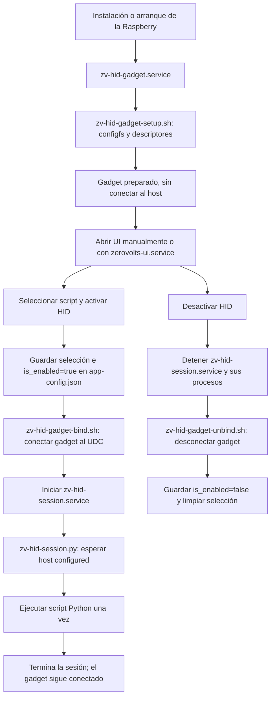
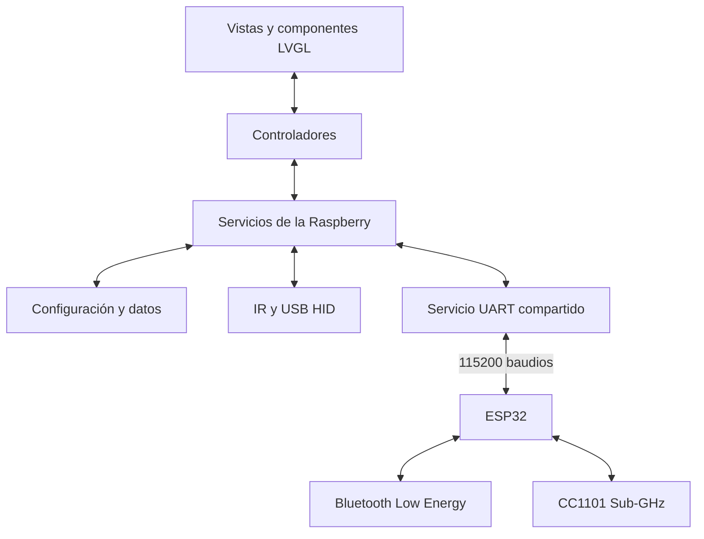

# ZeroVolts UI

ZeroVolts es un proyecto personal con el que quiero construir una herramienta portátil para experimentar con infrarrojo, Bluetooth Low Energy, USB HID y señales Sub-GHz desde una misma pantalla. Desarrollo la interfaz en C con LVGL, sobre una Raspberry Pi 4 con Parrot OS, y uso un ESP32 como coprocesador para BLE y radio.

El proyecto me sirve para aprender C, electrónica, interfaces gráficas, comunicación entre dispositivos y organización del software por responsabilidades. Quiero entender el recorrido completo de una acción: desde pulsar un botón hasta controlar el hardware, recibir un resultado y guardarlo. El montaje sigue en desarrollo; las funciones de radio y su compatibilidad física todavía son experimentales.

## Contenido

- [Hardware y conexiones](#hardware-y-conexiones)
  - [Pines GPIO de la Raspberry Pi](#pines-gpio-de-la-raspberry-pi)
  - [CC1101 conectado al ESP32](#cc1101-conectado-al-esp32)
- [Entorno de desarrollo](#entorno-de-desarrollo)
- [Instalación y configuración](#instalación-y-configuración)
  - [Flujo de servicios HID](#flujo-de-servicios-hid)
- [Compilar y ejecutar la aplicación](#compilar-y-ejecutar-la-aplicación)
- [Arquitectura del sistema](#arquitectura-del-sistema)
  - [Comunicación UART con el ESP32](#comunicación-uart-con-el-esp32)
- [Funciones implementadas](#funciones-implementadas)

## Hardware y conexiones

| Elemento | Uso en el montaje |
|---|---|
| Raspberry Pi 4 con Parrot OS | Interfaz, archivos, infrarrojo y USB HID. |
| Pantalla SPI táctil de 320 × 240 | Salida por framebuffer y entrada táctil mediante evdev; el touch se identifica como ADS7846. |
| Dos pulsadores | NAV para mover el foco y SELECT para confirmar. |
| Receptor y circuito transmisor IR | Aprender y enviar señales de mandos. |
| ESP32 DevKit | Escaneo/conexión BLE y control del CC1101; enlace UART con la Raspberry. |
| CC1101 y antena | Captura y reproducción experimental de pulsos Sub-GHz. |
| Puerto USB-C de datos de la Raspberry | Conexión al host como teclado HID. Requiere cable de datos y alimentación suficiente para el montaje. |

El firmware se mantiene en [zerovolts_firmware](../zerovolts_firmware/README.md). Debe compilarse y cargarse en el ESP32 para utilizar BLE y Sub-GHz.

### Pines GPIO de la Raspberry Pi

Los números GPIO son BCM; la columna «Pin físico» corresponde al conector de 40 pines.

| Función | GPIO | Pin físico | Conexión |
|---|---|---|---|
| Receptor IR | 5 | 29 | Salida del receptor. |
| Transmisor IR | 6 | 31 | Entrada del circuito transmisor. |
| UART TX | 12 | 32 | RX del ESP32, GPIO 16. |
| UART RX | 13 | 33 | TX del ESP32, GPIO 17. |
| Tierra UART | GND | 34 | Tierra del ESP32. |
| SELECT | 26 | 37 | Pulsador hacia GND. |
| NAV | 21 | 40 | Pulsador hacia GND. |
| Tierra de botones | GND | 39 | Referencia común. |

Los botones son activos en bajo: al pulsar llevan la entrada a GND. Sus pull-up se configuran durante el arranque. GPIO y UART usan niveles de 3,3 V. En este montaje el conector de pantalla ocupa la zona de pines físicos 1–26, aunque no todos se utilizan eléctricamente; revisa su pinout antes de reutilizarlos.

### CC1101 conectado al ESP32

| Señal CC1101 | Conexión ESP32 | Uso |
|---|---|---|
| VCC / GND | 3,3 V / GND | Alimentación y tierra. |
| SCK | GPIO 14 | Reloj SPI. |
| MOSI | GPIO 13 | Datos hacia el módulo. |
| MISO / GDO1 | GPIO 25 | Datos desde el módulo. |
| CSN | GPIO 5 | Selección SPI. |
| GDO0 | GPIO 27 | Pulsos de radio. |
| GDO2 | GPIO 26 | Conexión prevista en el firmware. |

Estas asignaciones están definidas en los headers del firmware. Si las cambias, adapta también el cableado.

El enlace entre las dos placas cruza TX y RX y comparte tierra:

```text
Raspberry Pi                         ESP32
GPIO 12 / TX (pin físico 32) -------> GPIO 16 / RX
GPIO 13 / RX (pin físico 33) <------- GPIO 17 / TX
GND          (pin físico 34) -------- GND
```

Los GPIO de cada tabla pertenecen a su placa: por ejemplo, el GPIO 13 de la Raspberry es UART RX y el GPIO 13 del ESP32 es MOSI del CC1101. NAV y SELECT se conectan entre su GPIO y GND; `gpio=21=pu` y `gpio=26=pu` mantienen el nivel alto cuando están sueltos.


## Entorno de desarrollo

Versiones registradas en la instalación actual; sirven como referencia para reproducir el entorno:

| Componente | Versión |
|---|---|
| Sistema | Parrot Security 6.4 (lorikeet), ARM64 |
| Kernel | `6.12.93+rpt-rpi-v8` |
| GCC | `12.2.0` (Debian `12.2.0-14+deb12u1`) |
| Make / CMake | `4.3` / `3.25.1` |
| Python | `3.11.2` |
| libgpiod / libevdev | `1.6.3` / `1.13.0` |
| ir-ctl | `1.22.1` |
| LVGL | `9.4.0` en las cabeceras locales |

El ESP32 usa PlatformIO Core `6.2.0`, plataforma `espressif32 6.12.0`, ESP-IDF `5.5.0` y GCC Xtensa `14.2.0`. Su preparación se explica en el [README del firmware](../zerovolts_firmware/README.md#entorno-de-desarrollo-actual).

## Instalación y configuración

El orden de preparación es: dependencias y LVGL → configuración de arranque → configuración de la aplicación → servicios → compilación y ejecución. Los pasos siguientes corresponden al montaje descrito; adapta dispositivos y pantalla si tu hardware es diferente.

### 1. Dependencias y compilación de LVGL

Instala las herramientas en la Raspberry:

```bash
sudo apt update
sudo apt install build-essential cmake git python3 pkg-config libevdev-dev libgpiod-dev v4l-utils evtest sudo kmod udev util-linux xxd bsdextrautils
```

`libgpiod` controla los botones, `libevdev` da soporte a la entrada y `v4l-utils` incluye `ir-ctl`. El driver de botones usa la API de **libgpiod 1.x**; usar la 2.x requiere adaptarlo.

**Compila LVGL antes de la UI.** El Makefile enlaza una biblioteca externa y no descarga ni construye LVGL. Sigue el [tutorial de instalación y compilación de LVGL para Raspberry Pi](https://zerovolts-site.pages.dev/meta/03-lvgl-raspberry/#2-herramientas-necesarias-y-descarga-de-lvgl) para descargar el port y preparar su entorno.

Edita `lv_conf.defaults` y conserva estos valores, escritos como `NOMBRE valor`, sin `#define`:

```text
LV_COLOR_DEPTH 16
LV_USE_LINUX_FBDEV 1
LV_LINUX_FBDEV_RENDER_MODE LV_DISPLAY_RENDER_MODE_DIRECT
LV_LINUX_FBDEV_BUFFER_COUNT 2
LV_USE_EVDEV 1
LV_USE_LIBINPUT 0
LV_USE_FS_STDIO 1
LV_FS_STDIO_LETTER 'A'
LV_FS_STDIO_PATH ""
LV_USE_LODEPNG 1
LV_FONT_MONTSERRAT_10 1
LV_FONT_MONTSERRAT_12 1
LV_FONT_MONTSERRAT_14 1
LV_FONT_DEFAULT &lv_font_montserrat_14
LV_USE_OS LV_OS_NONE
LV_USE_STDLIB_MALLOC LV_STDLIB_CLIB
```

| Grupo de opciones | Para qué se usa |
|---|---|
| Color y FBDEV | Color de 16 bits, dibujo directo al framebuffer y dos buffers. |
| EVDEV | Entrada táctil mediante los dispositivos Linux de entrada. |
| FS STDIO | Acceso a archivos desde LVGL con la unidad `A:`. |
| LODEPNG | Lectura de los iconos PNG. |
| Montserrat | Fuentes de 10, 12 y 14 puntos utilizadas por la interfaz. |
| OS y memoria | Sin integración de SO en LVGL y memoria asignada con la biblioteca C. |

El port local también tiene demos, fuentes adicionales y herramientas de diagnóstico activadas; el bloque anterior recoge la configuración que debe conservar esta aplicación. La configuración generada actualmente incluye opciones que faltan en el archivo de defaults local, como la fuente de 10 puntos y LODEPNG: añádelas al archivo de origen antes de regenerarlo.

Desde `lv_port_linux`, compila:

```bash
cmake -S . -B build -DCONFIG=default -DBUILD_SHARED_LIBS=OFF
cmake --build build --target lvgl -j2
```

`CONFIG=default` conserva tus ajustes; seleccionar otro perfil puede reemplazar `lv_conf.defaults`. Se generan `build/lv_conf.h` y `build/lvgl/lib/liblvgl.a`. La UI utiliza ambos junto con las cabeceras del port, por lo que debes recompilar LVGL después de cambiar sus opciones.

### 2. Configuración de arranque de la Raspberry

Edita `/boot/firmware/config.txt`. Este bloque reúne los parámetros activos del montaje actual; integra los valores en el archivo existente, sin duplicar overlays ni reemplazar ajustes propios de tu sistema:

```ini
dtparam=i2c_arm=on
dtparam=spi=on
dtparam=audio=on
camera_auto_detect=1
display_auto_detect=1
auto_initramfs=1
dtoverlay=vc4-kms-v3d
max_framebuffers=2
disable_fw_kms_setup=1
arm_64bit=1
disable_overscan=1
arm_boost=1

[cm4]
otg_mode=1

[all]
dtoverlay=dwc2,dr_mode=peripheral
dtoverlay=piscreen,drm,speed=18000000,rotate=90
dtoverlay=gpio-ir-tx,gpio_pin=6
dtoverlay=gpio-ir,gpio_pin=5
gpio=21=pu
gpio=26=pu
dtoverlay=uart5
```

| Parámetro | Significado en esta configuración |
|---|---|
| `dtparam=i2c_arm=on` | Habilita el bus I²C del procesador; no lo usa directamente la UI actual. |
| `dtparam=spi=on` | Habilita SPI, utilizado por la pantalla y el touch. El SPI del CC1101 pertenece al ESP32. |
| `dtparam=audio=on` | Habilita el audio integrado; es un ajuste del sistema, sin función propia en la UI. |
| `camera_auto_detect=1` | Carga overlays de cámaras reconocidas; no es requisito de ZeroVolts. |
| `display_auto_detect=1` | Detecta pantallas DSI compatibles; la pantalla SPI se configura por separado. |
| `auto_initramfs=1` | Carga automáticamente un initramfs compatible si está disponible. |
| `dtoverlay=vc4-kms-v3d` | Activa el controlador gráfico VC4 con KMS. |
| `max_framebuffers=2` | Permite hasta dos framebuffers gestionados por el firmware; no equivale a los dos buffers de LVGL. |
| `disable_fw_kms_setup=1` | Evita que el firmware añada una selección de modo de vídeo al kernel. |
| `arm_64bit=1` | Selecciona la ejecución del kernel en 64 bits. |
| `disable_overscan=1` | Desactiva la compensación de bordes del modo de vídeo del firmware. |
| `arm_boost=1` | Permite la frecuencia elevada de CPU admitida por la placa y el firmware. |
| `[cm4]` y `otg_mode=1` | Ajuste exclusivo de Compute Module 4 para el controlador USB host. No se aplica a esta Raspberry Pi 4. |
| `[all]` | Hace que las líneas siguientes se apliquen a todas las placas. |
| `dtoverlay=dwc2,dr_mode=peripheral` | Activa el controlador USB DWC2 en modo dispositivo, necesario para el gadget HID. |
| `dtoverlay=piscreen,drm,speed=18000000,rotate=90` | Carga el overlay de pantalla; `drm` selecciona DRM/KMS, `speed` fija SPI en 18 MHz y `rotate` gira la imagen 90 grados. |
| `dtoverlay=gpio-ir-tx,gpio_pin=6` | Transmisión IR por GPIO 6. |
| `dtoverlay=gpio-ir,gpio_pin=5` | Recepción IR por GPIO 5. |
| `gpio=21=pu` y `gpio=26=pu` | Activa pull-up para NAV y SELECT, manteniendo nivel alto al soltar los botones. |
| `dtoverlay=uart5` | Habilita UART5; sin CTS/RTS, el enlace usa GPIO 12 y 13. |

Los parámetros generales de vídeo, audio y detección se conservan del sistema; no todos son requisitos de la aplicación. La referencia local de overlays está en `/boot/firmware/overlays/README`.

En `/boot/firmware/cmdline.txt`, conserva la **única línea existente** y añade este argumento separado del anterior por un espacio:

```text
modules-load=dwc2,libcomposite
```

La coma separa los nombres de módulos dentro de ese argumento. No lo unas por una coma a otro parámetro, como `cfg80211.ieee80211_regdom`. Si ya existe `modules-load=...`, incorpora los módulos a esa lista. No copies identificadores de partición de otra instalación. Reinicia después de guardar los cambios.

### 3. Configuración de la aplicación

Antes de ejecutar, revisa [app-config.json](app-config.json). La aplicación guarda cambios de selección HID y configuración en ese archivo; edítalo con la UI y la sesión HID detenidas.

| Campo | Valor del montaje y propósito |
|---|---|
| `version` | `"0.5"`: texto de versión de la barra superior. |
| `display.fb_device` | `"/dev/fb0"`: framebuffer de la pantalla. Comprueba cuál corresponde al TFT. |
| `uart.device` | `"/dev/ttyAMA5"`: enlace con el ESP32. |
| `uart.baudrate` | `115200`: debe coincidir con el firmware. |
| `hid.script_list_path` | `"data/badusb/"`: carpeta de scripts Python seleccionables. |
| `hid.script_selected_path` | `""` inicialmente; la UI guarda la selección. |
| `hid.is_enabled` | `false` inicialmente. Si conservas `true`, la UI intenta reactivar HID al arrancar; no representa el resultado final del script. |
| `hid.config_scripts` | `"scripts"`: carpeta del proyecto con bind/unbind; no es el directorio de instalación del sistema. |
| `ir.remotes_path` | `"data/ir/remotes/"`: mandos y botones aprendidos. |
| `ir.backend` | `"irctl"`: backend actual basado en `ir-ctl`. |
| `ir.tx_device` / `ir.rx_device` | `"/dev/lirc0"` / `"/dev/lirc1"`: transmisión y recepción; comprueba la numeración real. |
| `ir.learn_timeout_ms` | `5000`: plazo de aprendizaje en milisegundos. |
| `ir.use_on_screen_keyboard` | `true`: teclado en pantalla para introducir nombres. |
| `subghz.signals_path` | `"data/subghz/signals"`: capturas `.sub` guardadas. |

El archivo se busca un nivel por encima de la carpeta del ejecutable. Conserva `bin/`, `app-config.json`, `assets/`, `scripts/` y `data/` en la estructura del repositorio. Las rutas relativas de IR y HID se resuelven desde la raíz del proyecto; la de Sub-GHz depende del directorio de ejecución. Por eso esta guía inicia la UI desde la raíz.

El touch se detecta automáticamente en `/proc/bus/input/devices`. El intercambio de ejes y la calibración (`296, 294, 3931, 3843`) están en [main.c](main.c); no son campos del JSON y deben ajustarse si cambia la pantalla.

### 4. Instalación de servicios

Con la configuración HID inicial en `false` y cualquier instancia de la UI cerrada, ejecuta desde la raíz del repositorio:

```bash
sudo bash scripts/install-hid.sh
sudo systemctl disable --now zerovolts-ui.service
```

El instalador copia el setup del gadget y el watcher a `/usr/local/lib/zerovolts/hid`, instala las tres unidades en `/etc/systemd/system` y completa las rutas del proyecto. Habilita e inicia tanto el gadget como la UI. **El segundo comando detiene y deshabilita la UI automática para mantener la ejecución manual como procedimiento predeterminado de esta guía.** Repítelo después de reinstalar si quieres conservar ese modo.

| Servicio | Responsabilidad | Cuándo se ejecuta |
|---|---|---|
| [zv-hid-gadget.service](scripts/zv-hid-gadget.service) | Carga y prepara configfs, descriptores USB y teclado HID de reportes de 8 bytes. Deja el gadget sin conectar al host. | Al instalar y en los siguientes arranques. Es `oneshot`; `active (exited)` significa que terminó la preparación. |
| [zv-hid-session.service](scripts/zv-hid-session.service) | Ejecuta el watcher, que lee la selección, espera la enumeración USB y lanza el script Python una vez. Detenerlo termina los procesos de la sesión. | La UI lo inicia y detiene al activar/desactivar HID. No se habilita al arrancar. |
| [zerovolts-ui.service](scripts/zerovolts-ui.service) | Ejecuta la aplicación desde su directorio, espera al gadget y reinicia la UI si falla. Omite el inicio si falta el binario. | Al solicitarlo con `start`, o al encender si lo habilitas con `enable`. |

Las tres unidades se ejecutan como root porque no declaran `User=`. Este procedimiento no necesita configurar grupos de dispositivos para el usuario. El watcher y los scripts seleccionados también se ejecutan como root. Ejecutar la UI sin privilegios requiere permisos adicionales; sus llamadas HID usan `sudo` y podrían pedir contraseña.

Los scripts bind/unbind siguen en la carpeta indicada por `hid.config_scripts`; conectan/desconectan el gadget. Si mueves el repositorio o actualizas los scripts instalados, repite la instalación con la UI y la sesión cerradas. No copies directamente las plantillas `.service`, porque contienen `@PROJECT_ROOT@` que debe sustituir el instalador.

### Flujo de servicios HID

La preparación del gadget, su conexión al host y la ejecución del script son pasos distintos. `zv-hid-gadget.service` deja creado el teclado USB; la UI decide cuándo conectarlo e iniciar `zv-hid-session.service`. La UI puede abrirse manualmente o mediante su servicio opcional.



Bind escribe el controlador USB en el atributo `UDC` del gadget; unbind lo vacía. El watcher lee la configuración al iniciar, espera a que el host termine la enumeración y ejecuta el script seleccionado. Al terminar no vuelve a lanzarlo por reconectar el cable: hace falta una sesión nueva. Si la UI arranca con `is_enabled=true`, intenta reactivar HID con la selección guardada.

## Compilar y ejecutar la aplicación

Desde la raíz del repositorio, compila con tu usuario normal:

```bash
make
```

El Makefile busca LVGL en `~/git/lv_port_linux`. Si está en otra ubicación, usa `make LVPORT=/ruta/a/lv_port_linux`. Para limpiar los ejecutables, utiliza `make clean`.

### Comprobar el montaje

Después de reiniciar y preparar los servicios:

```bash
ls -l /dev/fb0 /dev/gpiochip0 /dev/ttyAMA5 /dev/lirc0 /dev/lirc1
cat /proc/bus/input/devices
ls -l /dev/input/event*
ls /sys/class/udc
sudo systemctl status zv-hid-gadget.service
ls -l /dev/hidg0
```

Adapta los nombres al JSON y al hardware. Para identificar el touch, puedes usar `sudo evtest /dev/input/eventN`. Los botones usan `gpiochip0`. UART, LIRC y HID corresponden a sus módulos; si falta alguno, revisa el overlay y la conexión. El gadget debe estar preparado antes de activar HID desde la UI, porque bind ocurre antes de iniciar la sesión.

### Ejecución manual, opción predeterminada

```bash
sudo systemctl start zv-hid-gadget.service
sudo ./bin/zero-volts-ui
```

La instalación anterior deja deshabilitado el servicio de la UI. Mantén una sola instancia de la aplicación. La aplicación se ejecuta como root para acceder a los dispositivos con la configuración actual. `make run` o `./bin/zero-volts-ui` no elevan privilegios; su funcionamiento depende de los permisos del usuario. Usa `Ctrl+C` en la terminal para terminar la instancia manual.

### Ejecución mediante el servicio

Cierra primero la instancia manual. Para iniciar la UI sin habilitar el arranque automático:

```bash
sudo systemctl start zerovolts-ui.service
```

Para habilitarla al encender la Raspberry e iniciarla ahora:

```bash
sudo systemctl enable --now zerovolts-ui.service
```

Arranca en `multi-user.target`, sin escritorio gráfico ni inicio de sesión del usuario. Si instalaste antes de compilar, ejecuta `start` cuando el binario esté listo; compilar por sí solo no inicia el servicio. Para volver al modo manual, usa `sudo systemctl disable --now zerovolts-ui.service`.

Para consultar estado y errores:

```bash
sudo systemctl status zerovolts-ui.service zv-hid-gadget.service zv-hid-session.service
sudo journalctl -u zerovolts-ui.service -u zv-hid-gadget.service -u zv-hid-session.service -b -n 100 --no-pager
```

## Arquitectura del sistema

La Raspberry ejecuta Linux, la interfaz y las operaciones de archivos, IR y USB HID. El ESP32 se ocupa de BLE y del CC1101. Esto permite conservar las herramientas Linux y delegar la radio y temporización de pulsos al microcontrolador.



Las vistas presentan información; los controladores coordinan acciones y estados; los servicios acceden al sistema y al hardware. Por ejemplo, para reproducir una señal Sub-GHz, el controlador recibe la selección, el servicio carga el archivo y envía sus pulsos al ESP32, y las respuestas actualizan la pantalla. El desacoplamiento sigue en desarrollo: BLE procesa parte de sus mensajes UART desde el controlador.

`main.c` inicializa configuración, pantalla y botones, y mantiene el bucle LVGL/UART. `app_context` conserva dispositivos BLE y sesiones de captura compartidas. El protocolo UART utiliza líneas de texto con órdenes y campos separados por `|`; el firmware devuelve inicio, datos, finalización o error. El descubrimiento GATT actual ocurre automáticamente después de conectar.

| Directorio o archivo | Responsabilidad |
|---|---|
| `page/` | Pantallas y controladores de `hid`, `ir`, `bt` y `sub_ghz`; navegación. |
| `components/` | Controles LVGL y tema reutilizables. |
| `service/` | HID, IR, UART y captura/archivos/replay Sub-GHz. |
| `drivers/` | Botones físicos con libgpiod. |
| `config.[ch]` / `app-config.json` | Carga, persistencia y resolución de configuración. |
| `utils/` | Archivos, JSON, cadenas, logs y errores. |
| `scripts/` | Soporte del gadget HID, watcher, instalador y unidades systemd. |
| `assets/` / `data/` | Recursos visuales y datos del usuario. |
| `examples/` / `docs/` / `case/` | Ejemplos, documentación y archivos de carcasa. |
| `bin/` | Ejecutables generados. |

Los scripts HID se guardan en `data/badusb/`, los mandos IR en `data/ir/remotes/<mando>/` con metadatos y botones `.raw`, y las señales Sub-GHz en `data/subghz/signals/`. El log general queda en `data/app-log.log`; el watcher mantiene `zv-hid-session.log` en la raíz del proyecto.

### Comunicación UART con el ESP32

La Raspberry abre el puerto definido en `uart.device`, actualmente `/dev/ttyAMA5`, a **115200 baudios, 8 bits, sin paridad y un bit de parada (8N1)**. El ESP32 recibe las órdenes y devuelve eventos por el mismo enlace. BLE y Sub-GHz comparten este canal; IR y HID se controlan en la Raspberry.

El protocolo propio usa texto, con un mensaje por línea. `|` separa campos y muchos datos se expresan como `clave=valor`. El servicio UART de la UI entrega cada respuesta al módulo correspondiente y gestiona plazos de espera. Por ejemplo, un escaneo BLE puede intercambiar estas líneas; las flechas indican la dirección y no forman parte del mensaje:

```text
Raspberry → ESP32: SCAN
ESP32 → Raspberry: SCAN:START
ESP32 → Raspberry: SCAN:DEVICE|name=Sensor|mac=AA:BB:CC:DD:EE:FF|rssi=-58|manufacturer=|service=|appearance=|connectable=1|addr_type=0
ESP32 → Raspberry: SCAN:DONE
```

`SCAN:START` indica el inicio, cada `SCAN:DEVICE` describe un dispositivo y `SCAN:DONE` cierra el escaneo. `rssi` expresa la señal en dBm, `connectable` indica si admite conexión y `addr_type` identifica el tipo de dirección BLE. Puede haber varios resultados o ninguno. Otra orden del protocolo es `SUBGHZ_CAPTURE|freq_hz=433920000|timeout_ms=30000`, que solicita una captura a 433,92 MHz durante un máximo de 30 segundos.

Las referencias para modificar el protocolo son [service/uart_commands.h](service/uart_commands.h), [service/uart_service.c](service/uart_service.c) y el dispatcher `src/zv_uart_protocol.c` del firmware. Las órdenes y respuestas deben mantenerse compatibles en ambos proyectos.

## Funciones implementadas

### Navegación

La pantalla principal ofrece Bad USB, Infrared, Bluetooth y Sub-GHz. Se puede usar el touch o los botones NAV y SELECT para mover el foco, confirmar opciones y operar desplegables y teclado en pantalla. Los botones y la adaptación de sus pulsaciones a LVGL se gestionan desde `main.c`.

### USB HID / Bad USB

Permite listar scripts Python `.py`, seleccionar uno y activar/desactivar el teclado USB. La UI guarda la selección antes de conectar el gadget y arrancar la sesión. El watcher espera el estado USB `configured`, ejecuta el script una vez y termina. Reconectar el cable no vuelve a ejecutarlo mientras no se inicie una sesión nueva; al abrir otra vez la UI con `is_enabled=true`, sí intenta reactivar HID.

Para repetir, desactiva, selecciona el script y activa de nuevo. Al desactivar se detiene la sesión y se desconecta el gadget. Cada script escribe reportes en `/dev/hidg0` y se encarga de liberar las teclas. La UI todavía no presenta el progreso ni el resultado final del proceso, y no hay traducción general de layouts de teclado.

La conexión al host utiliza el puerto USB-C de datos de la Pi 4; sus puertos USB-A no son el puerto gadget de este montaje.

### Infrarrojo

Permite crear mandos, añadir botones, aprender señales con un plazo de captura, guardarlas y transmitirlas con `ir-ctl`. Los mandos quedan disponibles entre ejecuciones. El aprendizaje incluye validación básica de pulsos y reintentos cuando la captura no resulta utilizable.

El backend actual es `irctl`. La fiabilidad con distintas familias de mandos, la cancelación y el envío sin bloquear la interfaz siguen siendo áreas de mejora.

### Bluetooth Low Energy

Permite buscar dispositivos cercanos, filtrar resultados, consultar nombre, dirección y señal, y conectarse a los periféricos que lo permitan. El ESP32 descubre servicios y características GATT y la UI muestra esa estructura y sus propiedades.

Es un explorador BLE: todavía no ofrece una interfaz general para leer/escribir características o suscribirse a notificaciones. El firmware se ocupa de las operaciones BLE y la Raspberry presenta sus resultados.

### Sub-GHz

Permite seleccionar frecuencia, capturar pulsos, verlos en un gráfico, guardar o descartar la captura y listar señales para reproducirlas con repeticiones. Los archivos se guardan en formato `.sub` RAW y el envío se realiza por bloques con confirmaciones del ESP32.

La UI ofrece 315, 380, 381, 433,92, 868 y 915 MHz; que una opción aparezca no significa que esté validada con el módulo y antena instalados. La base de radio es OOK a 433,92 MHz. El replay admite hasta 256 duraciones de pulsos; los perfiles, la integridad de las capturas y la compatibilidad física siguen en desarrollo. Guardar una captura no garantiza que el receptor acepte su reproducción.
